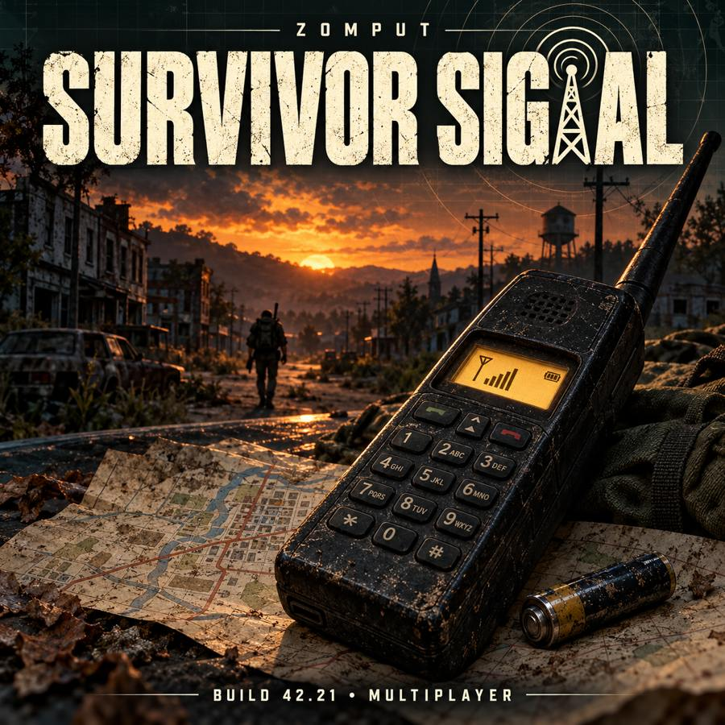

# Zomput-Survivor_Signal

By **TEEPUT**, for Project Zomboid **42.21** dedicated multiplayer servers.

[Steam Workshop](https://steamcommunity.com/sharedfiles/filedetails/?id=3820241990) · Workshop ID: `3820241990` · Mod ID: `ZomputSurvivorSignal`

생존자에게 무게 **0.1**인 배터리식 전자기기 핸드폰을 한 대 지급합니다. 핸드폰 우클릭 → **생존자 위치 조회**로 게임 날짜마다 1회 사용합니다. 게임 시간 00:00에 사용 제한이 초기화됩니다.

- 내구도와 배터리가 남은 핸드폰을 휴대한 다른 접속자의 조회 시점 위치를 팝업의 **거리(m)·지도 기준 8방향**과 미니맵에 표시합니다. 예: `2000m 남동`. 조회 당시 내 위치에서의 수평 직선거리(1타일=1m, 반올림)이며 기록을 다시 열어도 기준 위치는 바뀌지 않습니다. 가방 안의 핸드폰도 포함합니다.
- 분류는 **전자기기**이며 인벤토리에 내구도 막대, 우클릭 메뉴에 내구도와 배터리 잔량을 표시합니다.
- 일반 배터리(`Base.Battery`)를 교체·분리할 수 있습니다. 교체하면 기존 배터리를 남은 충전량 그대로 돌려받습니다. 즐겨찾기가 아닌 보유 배터리 중 충전량이 가장 많은 것을 사용하며, 빈 배터리와 완충 상태에서의 교체는 막습니다.
- 조회당 배터리 **3%**를 소모하며 대기 중에는 배터리를 소모하지 않습니다. 내구도 감소율을 0으로 설정해도 배터리는 사용합니다. 배터리 교체는 물리적 내구도를 수리하지 않습니다.
- 기본 내구도는 100이며 조회당 3포인트 감소합니다. 샌드박스 **생존자 신호 → 조회당 핸드폰 내구도 감소율**에서 정수 0~100을 설정합니다.
- 검색 결과가 없어도 사용 횟수와 내구도를 소모합니다. 남은 내구도가 소모량보다 적어도 마지막 조회는 성공하고 0이 됩니다.
- 마지막 사용으로 내구도가 0이 되어도 핸드폰을 휴대하는 동안 그날의 조회 기록은 볼 수 있습니다.
- 내구도 0 또는 배터리 없음·방전, 바닥·차량 보관, 사망·접속 종료·투명 관리자 캐릭터는 새 조회 대상에서 제외됩니다.
- 지도 표시는 실시간 추적이 아닙니다. 조회 이후 대상의 이동·사망은 기존 기록을 변경하지 않습니다. 조회자의 사망 또는 핸드폰 미소지 시 화면 표시만 지우며, 같은 캐릭터의 서버 저장 기록은 유지됩니다. 지난 날짜의 기록도 조회 당시 날짜·시간과 위치로 표시됩니다.
- 하루 1회 제한은 **캐릭터별**입니다. 같은 캐릭터로 재접속하거나 핸드폰을 교체해도 당일 제한은 유지되며, 사망 후 새 캐릭터는 같은 날 다시 조회할 수 있습니다.
- 핸드폰 우클릭 → **이전 조회 기록 보기**에서 이 캐릭터의 최근 **7회**를 불러옵니다. **더 이전 기록 / 더 최근 기록**으로 이동하며 창 닫기·자정·재접속·서버 재시작 후에도 보관됩니다. 조회 기록을 여는 데 사용 횟수·내구도·배터리를 소모하지 않으며 고장·방전된 핸드폰도 휴대 중이면 볼 수 있습니다.
- v1.2까지의 계정 제한은 새 캐릭터 제한에 이관하지 않습니다. v1.3 적용 후 조회부터 기록이 저장되며, 이전 버전에서 메모리에만 있던 기록은 복구할 수 없습니다. 새 캐릭터에게 죽은 캐릭터의 기록을 넘기지 않습니다.
- 기존 캐릭터는 모드를 처음 적용한 후 1대, 새 캐릭터는 새로 1대를 받습니다. 버리거나 잃어버린 핸드폰은 자동 재지급하지 않습니다.
- 수리·제작·무작위 전리품은 추가하지 않습니다. 싱글플레이는 지원 대상이 아닙니다.
- 서버가 미니맵을 허용해야 지도에 표시됩니다. 서버의 일반 플레이어 지도 공개 설정은 별개입니다.

## 기존 저장 호환

기존 잡템형 핸드폰은 소지품과 가방에서 전자기기로 1:1 변환됩니다. 내구도·즐겨찾기·사용자 지정 이름은 유지하며 최초 변환 시 배터리는 완충됩니다. 손에 장착한 구형 핸드폰은 장착을 해제하면 변환됩니다. 바닥이나 차량의 구형 핸드폰은 다시 소지하면 변환됩니다.

최초 지급은 클라이언트 인벤토리 초기화 후 서버가 재확인해 한 번만 처리합니다. 기존 핸드폰이 있으면 추가 지급하지 않습니다. 이미 생긴 중복품은 정상적으로 얻은 물건과 구별할 수 없어 자동 삭제하지 않습니다. 아이템 ID를 직접 지정하는 다른 모드의 필터는 새 ID `SurvivorSignal.PhoneDevice`로 다시 설정해야 합니다.

## Installation

Server and all clients must have identical mod files. Copy `Contents/mods/ZomputSurvivorSignal` into your local `Zomboid/mods` directory or install the Workshop release. Enable Mod ID `ZomputSurvivorSignal` (B42 server INI representation: `\ZomputSurvivorSignal`).

This repository contains only the mod, its artwork, documentation and tests. Deployment credentials, NAS addresses, server configuration, saves and private test infrastructure belong outside this repository.

See [validation results and remaining checks](VALIDATION.md).

## Tests

Run `lua tests/server_spec.lua` from the repository root (Lua 5.1+, or fengari). This checks server rules with test doubles; it does not replace two-client multiplayer gameplay verification.
